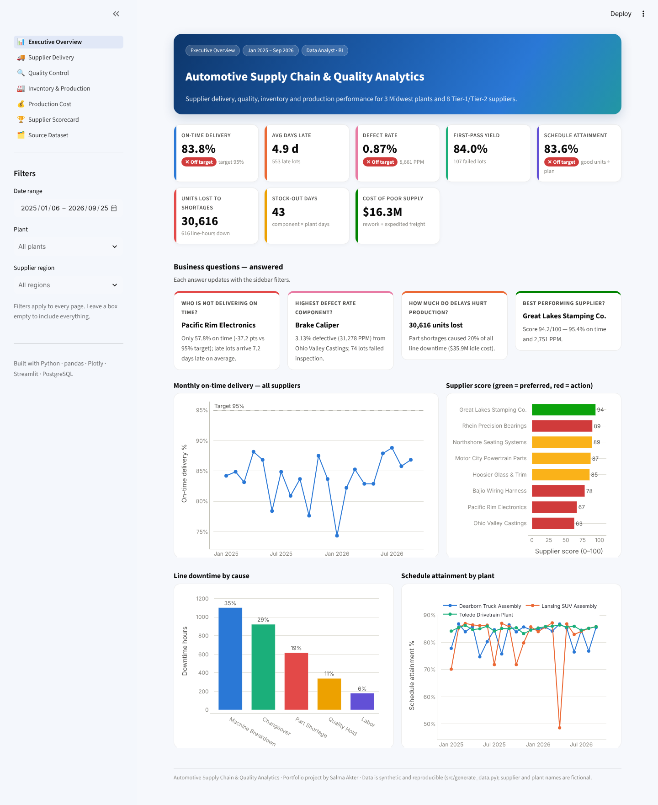
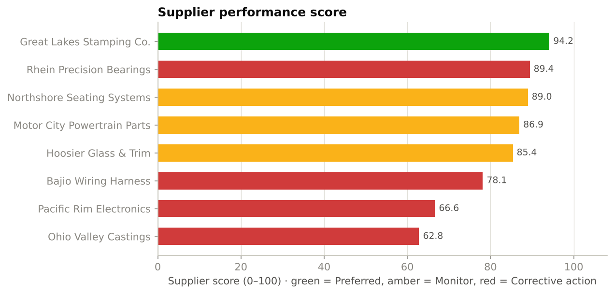
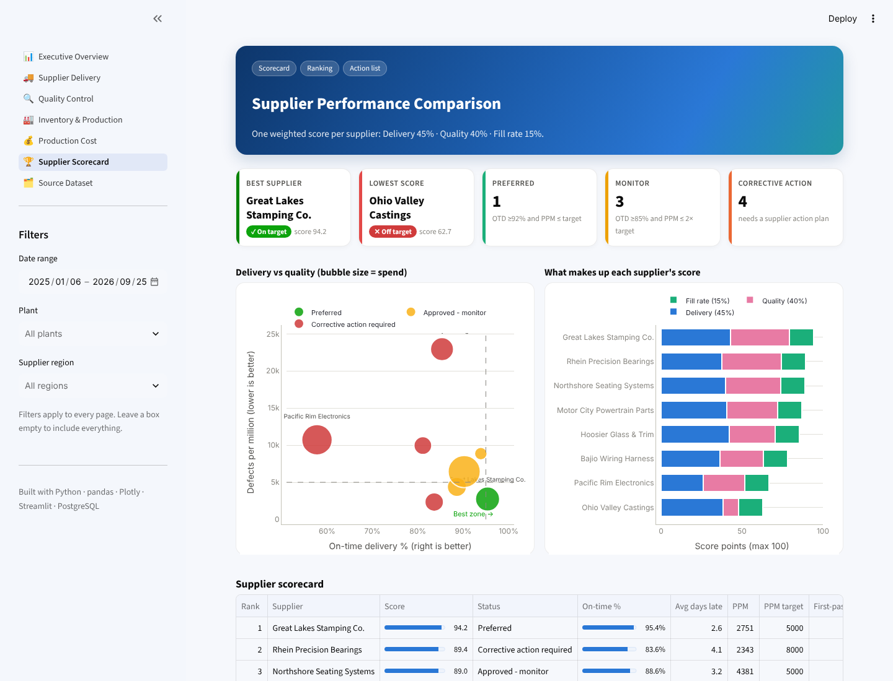
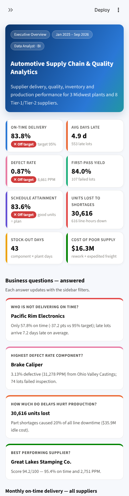
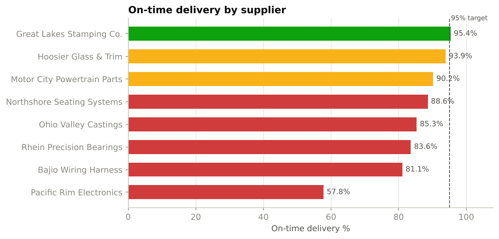
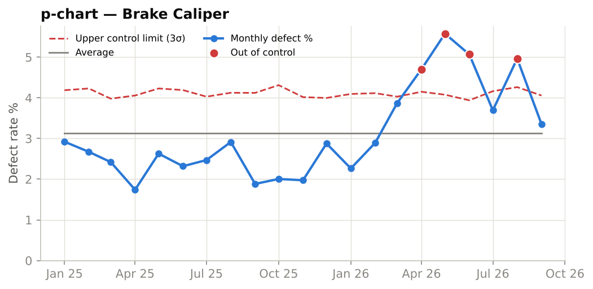
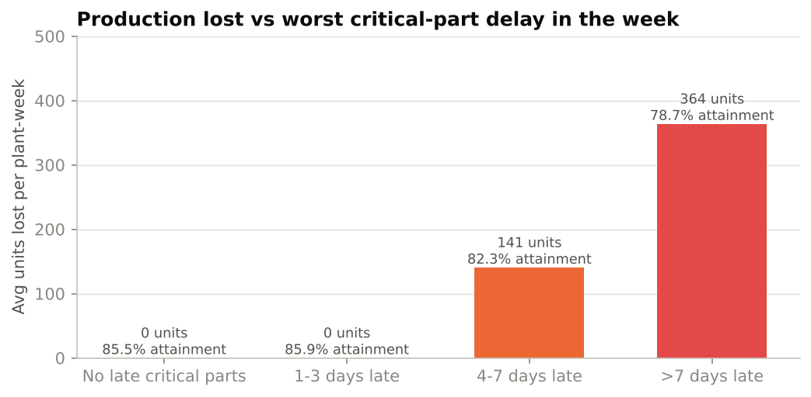
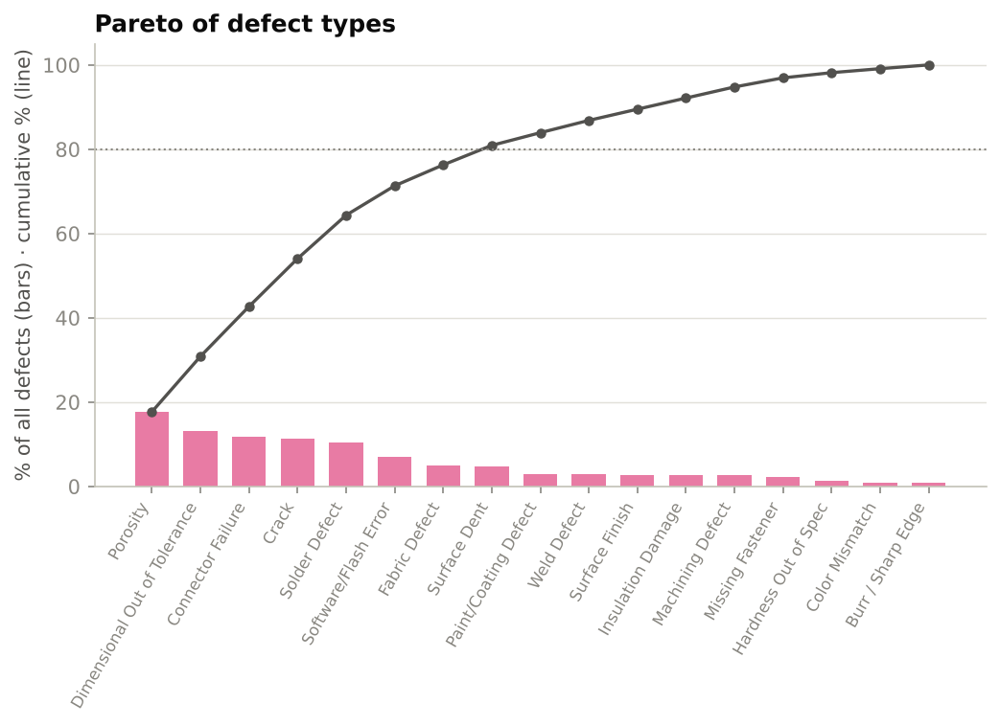

# 🚗 Automotive Supply Chain & Quality Analytics

**End-to-end Data Analyst / BI project** — supplier delivery performance, supply chain delays, inventory shortages,
production efficiency, defect rates, quality control and production cost for an automotive OEM
(3 Midwest plants · 8 Tier-1/Tier-2 suppliers · 20 components · Jan 2025 – Sep 2026).


> **🔴 Live dashboard:** [automotive-supply-chain-analytics.streamlit.app](https://automotive-supply-chain-analytics-73hqvavck5c9qvzqkd9uxz.streamlit.app/) ·
> **Report:** [Quality Analytics Report](reports/Quality_Analytics_Report.md) ·
> **SQL:** [18 business queries](sql/03_business_queries.sql) ·
> **Excel:** [Supplier Performance Workbook](excel/Supplier_Performance_Workbook.xlsx)



---

## 🎯 Business questions & answers

| Question | Answer (from the data) |
|---|---|
| **Which supplier is not delivering on time?** | **Pacific Rim Electronics** — only **57.8%** on time vs a 95% target; late lots are **7.2 days** late on average. 7 of 8 suppliers miss the target. |
| **Which component has the highest defect rate?** | **Brake Caliper** (Ohio Valley Castings) — **3.13%** defective (31,278 PPM). A p-chart shows a special-cause spike from **March 2026** (4 months above the control limit). |
| **How much do supply chain delays affect production?** | **30,616 units lost** and **616 line-hours** stopped. Delays ≤3 days are absorbed by safety stock; weeks with a **>7-day** critical-part delay lose **364 units per plant** and attainment drops from 85.5% to **78.7%**. |
| **Which supplier performs best?** | **Great Lakes Stamping Co.** — score **94.2/100** (95.4% on time, 2,751 PPM), the only *Preferred* supplier. |



---

## 📊 Dashboard (Python · Streamlit · Plotly)

A colorful, responsive 7-page dashboard with KPI cards and global filters (date range, plant, supplier region).

<p>


</p>

| Page | What it shows |
|---|---|
| 📊 **Executive Overview** | 8 KPI cards, the 4 business questions answered live, OTD trend, supplier score, downtime causes, attainment by plant |
| 🚚 **Supplier Delivery** | OTD by supplier vs target, delay-severity mix, supplier × month heat map, root causes, domestic vs overseas |
| 🔍 **Quality Control** | Defect rate by component, inspection results, defect Pareto (80/20), **SPC p-chart** with control limits |
| 🏭 **Inventory & Production** | Delay → lost-production analysis, stock-outs, days-of-supply vs safety stock, downtime by cause |
| 💰 **Production Cost** | Cost breakdown, cost of poor supplier performance, cost per unit trend, freight by mode |
| 🏆 **Supplier Scorecard** | Delivery vs quality bubble chart, score breakdown, ranked table, recommended actions |
| 🗂️ **Source Dataset** | Same questions answered on the original public 100-SKU dataset |

<p>




</p>

---

## 🗃️ Data model

```
            suppliers ──┐           plants
                        │              │
 components ────────────┼──────────────┤
     │                  │              │
     ├── purchase_orders (3,420 lots: promised vs actual date, delay reason, freight)
     │        └── quality_inspections (3,420: sample, defects, Pass/Conditional/Fail, rework cost)
     ├── inventory_daily  (17,100: stock, safety stock, shortages)
     └── production_daily (1,350: planned vs good units, downtime by cause, cost)
```

**Why generated data?** The public dataset (`data/raw/supply_chain_data.csv`, 100 SKUs, 5 suppliers) has no dates and no
promised-vs-actual delivery, so it can't measure on-time delivery or production loss. `src/generate_data.py` builds a
realistic automotive dataset (fixed seed = fully reproducible) calibrated to the public file's ranges
(lead time 1–30 days, defect rate 0–5%, Road/Rail/Sea/Air). It contains a real **cause-and-effect chain**:

`late delivery → safety stock runs out → part shortage → line downtime → lost units → higher cost`

Supplier and plant names are fictional.

---

## 🧮 SQL (PostgreSQL)

[`sql/03_business_queries.sql`](sql/03_business_queries.sql) — 18 queries in 6 sections, tested on PostgreSQL 16:

- **Delivery:** OTD % and gap to target, monthly trend, delay root causes, severity buckets (`FILTER`), transport modes
- **Quality:** defect rate & PPM by component, first-pass yield, **Pareto with window functions**, monthly spike check
- **Inventory:** stock-out days and days below safety stock
- **Production:** attainment & availability, **units lost to shortages**, downtime by cause (`UNION ALL`), supplier → stoppage link
- **Cost:** cost per unit by quarter, cost of poor supplier performance
- **Scorecard:** weighted supplier score with CTEs, `RANK()` and `CASE` status rules

Techniques: CTEs, window functions (`SUM() OVER`, `RANK()`), `FILTER`, `DATE_TRUNC`, `STRING_AGG`, multi-table joins.

---

## 📁 Project structure

```
automotive-supply-chain-analytics/
├── streamlit_app.py               # Streamlit entry point (navigation + filters)
├── app/
│   ├── ui.py                      # colors, CSS, KPI cards, chart style
│   └── pages/                     # 7 dashboard pages
├── src/
│   ├── generate_data.py           # builds the automotive dataset
│   ├── metrics.py                 # all KPI logic (pandas) — mirrors the SQL
│   ├── build_report.py            # writes the Quality Analytics Report + charts
│   └── build_excel.py             # writes the Excel workbook (live formulas)
├── sql/
│   ├── 01_schema.sql              # tables, keys, indexes
│   ├── 02_load_data.sql           # \copy the CSVs
│   └── 03_business_queries.sql    # 18 business queries
├── data/
│   ├── raw/supply_chain_data.csv  # original public dataset
│   └── processed/*.csv            # 7 analysis tables
├── reports/
│   ├── Quality_Analytics_Report.md
│   └── figures/*.png
├── excel/Supplier_Performance_Workbook.xlsx
├── docs/                          # setup & interview guides (Bengali)
├── .streamlit/config.toml         # dashboard theme
└── requirements.txt
```

---

## ▶️ Run it yourself

```bash
git clone https://github.com/<your-username>/automotive-supply-chain-analytics.git
cd automotive-supply-chain-analytics
pip install -r requirements.txt
streamlit run streamlit_app.py
```

Rebuild everything from scratch (optional):

```bash
pip install -r requirements-dev.txt
python src/generate_data.py     # data
python src/build_report.py      # report + charts
python src/build_excel.py       # Excel workbook
```

SQL: create a database `supply_chain`, then run `sql/01_schema.sql`, `sql/02_load_data.sql`, `sql/03_business_queries.sql`
(from the project folder) in psql or pgAdmin.

---

## 💡 Recommendations (from the report)

1. **Supplier Corrective Action Request (SCAR)** for Pacific Rim Electronics; raise ECU/ADAS safety stock from 3 to 7 days while qualifying a second source.
2. **8D problem-solving** with Ohio Valley Castings on brake-caliper porosity; 100% incoming inspection until 3 months are in control.
3. Weekly delivery reviews for every supplier below 90% OTD.
4. Use the scorecard in quarterly business reviews and reward Preferred suppliers with volume.

---

**Author:** Salma Akter · M.S. Computer & Information Technology · Data Analyst / BI portfolio
