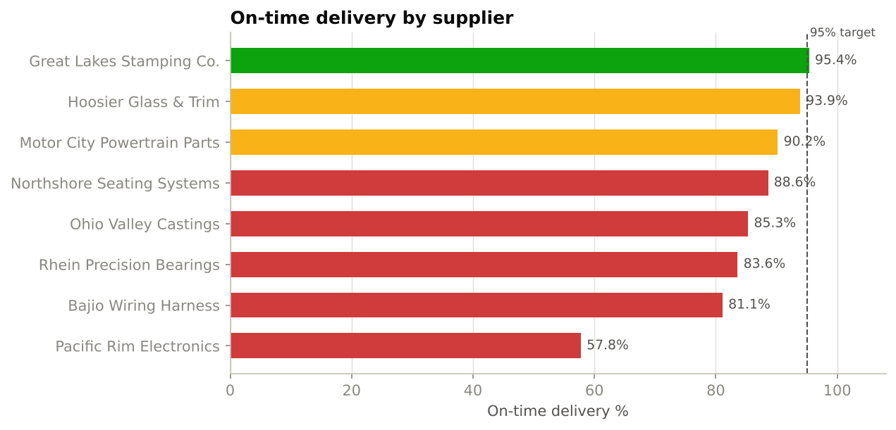
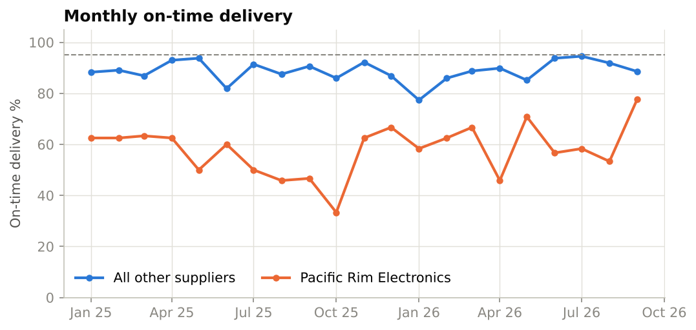
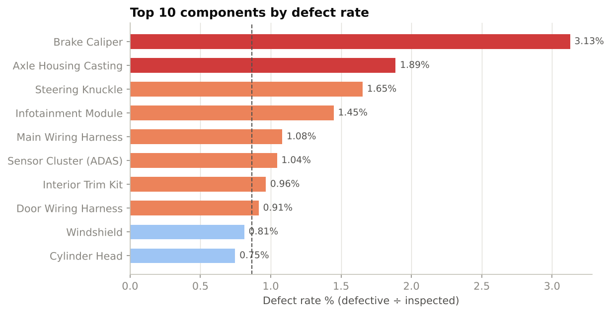
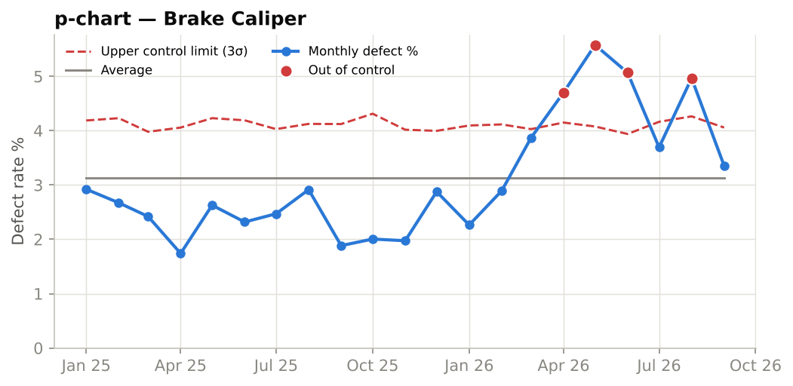
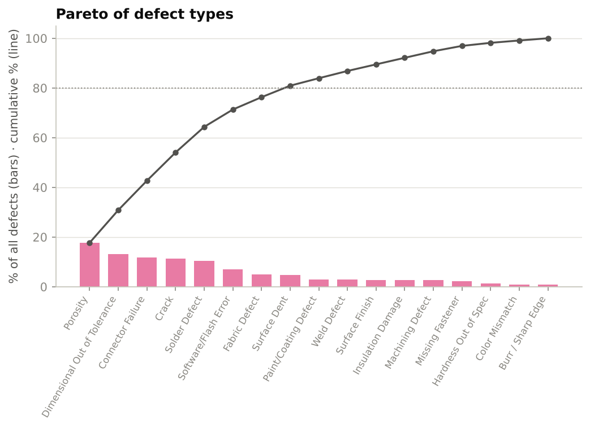
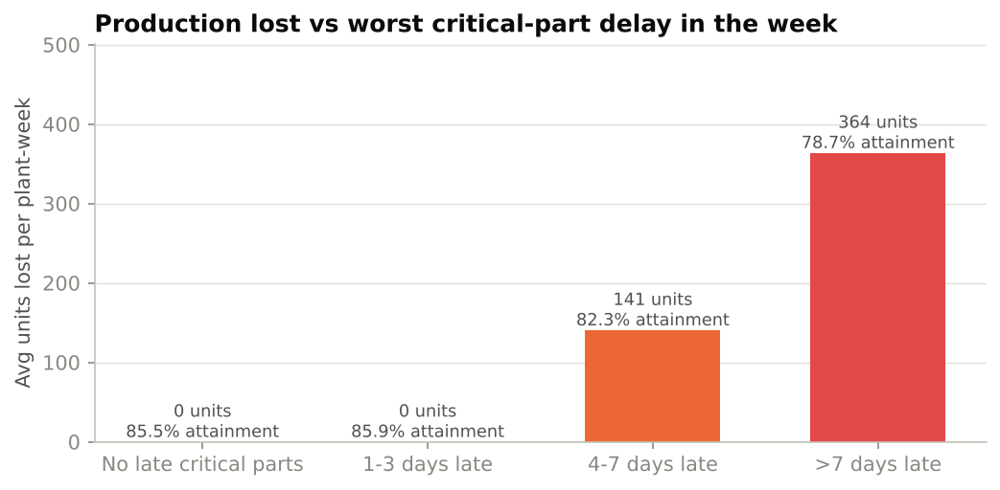
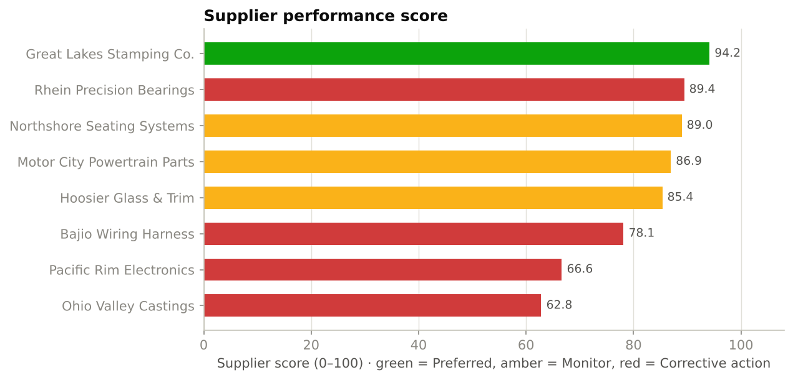
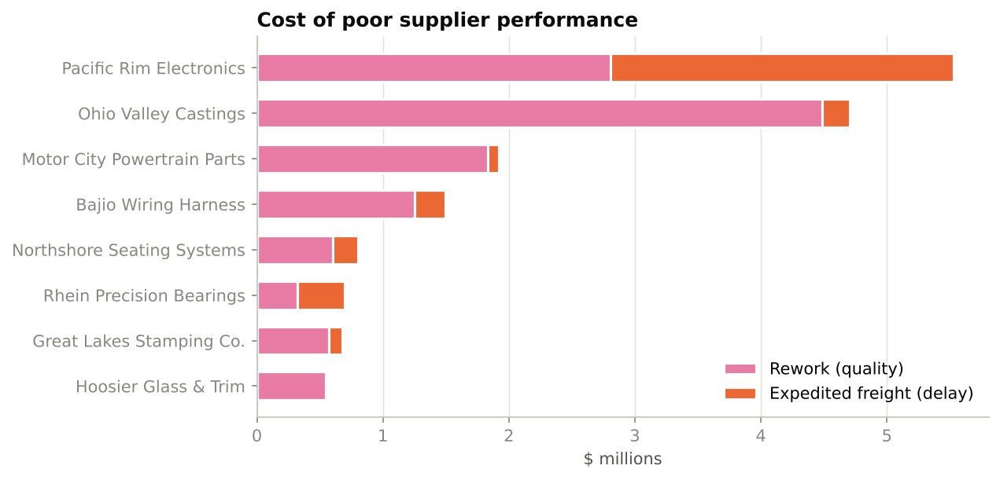

# Quality Analytics Report
### Automotive Supply Chain & Quality Analytics

**Prepared by:** Salma Akter · **Role focus:** Data Analyst / Business Intelligence
**Scope:** 8 suppliers · 20 components · 3 plants · 3,420 deliveries · 3,420 incoming inspections · Jan 2025 – Sep 2026
**Tools:** PostgreSQL (SQL), Python (pandas, Plotly, Streamlit, matplotlib), Excel

> Data note: the dataset is synthetic and reproducible (`src/generate_data.py`, seed 42). Its ranges are
> calibrated to the public supply chain dataset in `data/raw/`. Supplier and plant names are fictional.

---

## 1. Executive summary

| KPI | Result | Target | Status |
|---|---|---|---|
| On-time delivery (OTD) | **83.8%** | 95% | ❌ 7 of 8 suppliers below target |
| Incoming defect rate | **0.87%** (8,663 PPM) | ≤ 5,000 PPM (Tier 1) | ❌ |
| First-pass yield (lots) | **84.0%** | 95% | ❌ 107 lots failed |
| Schedule attainment | **83.6%** | 90% | ❌ |
| Units lost to part shortages | **30,616** | 0 | 616 line-hours stopped |
| Cost of poor supplier performance | **$16.4M** | — | rework + expedited freight |

**Four findings that matter most**

1. **Pacific Rim Electronics is the delivery problem.** Only **57.8%** of its lots arrive on time
   (-37.2 pts vs target), and late lots are **7.2 days** late on average.
   It supplies A-critical electronics, so it caused **38 of 43 stock-out days**.
2. **Brake Caliper (Ohio Valley Castings) has the highest defect rate: 3.13%**
   (31,278 PPM). The p-chart shows a special-cause shift from **March 2026**: the monthly rate rose
   from ~2.4% to ~4.6%, with **4 months above the upper control limit**.
3. **Delays only hurt production once they exceed safety stock.** Weeks whose worst critical-part delay
   was ≤3 days lost almost nothing; weeks with a **>7 day** delay lost **364 units per plant-week**
   and attainment fell to **78.7%** (vs 85.5% with no late critical parts).
   Part shortages caused **20%** of all line downtime.
4. **Great Lakes Stamping Co. is the best supplier** (score **94.2/100**, 95.4% OTD, 2,751 PPM)
   and the only one rated *Preferred*.

---

## 2. Supplier delivery performance

| Supplier | Region | Lots | OTD % | Avg days late | Worst delay (d) |
|---|---|---|---|---|---|
| Pacific Rim Electronics | Overseas | 540 | 57.8% | 7.2 | 25 |
| Bajio Wiring Harness | Nearshore | 360 | 81.1% | 3.8 | 14 |
| Rhein Precision Bearings | Overseas | 360 | 83.6% | 4.1 | 14 |
| Ohio Valley Castings | Domestic | 450 | 85.3% | 3.5 | 14 |
| Northshore Seating Systems | Nearshore | 360 | 88.6% | 3.2 | 10 |
| Motor City Powertrain Parts | Domestic | 450 | 90.2% | 2.3 | 11 |
| Hoosier Glass & Trim | Domestic | 360 | 93.9% | 2.4 | 5 |
| Great Lakes Stamping Co. | Domestic | 540 | 95.4% | 2.6 | 7 |

**Root causes of late deliveries** — Raw Material Shortage (23%),
Customs Clearance (19%) and Weather
(16%) explain 59% of late lots. The worst month for
Pacific Rim Electronics was during the Jul–Oct 2025 semiconductor raw-material shortage.
Overseas suppliers average 26-day lead times vs
8 days for domestic suppliers.

---

## 3. Quality control & defect rate

| Component | Supplier | Parts inspected | Defect % | PPM | Failed lots |
|---|---|---|---|---|---|
| Brake Caliper | Ohio Valley Castings | 60,810 | 3.13% | 31,278 | 74 |
| Axle Housing Casting | Ohio Valley Castings | 30,935 | 1.89% | 18,878 | 12 |
| Steering Knuckle | Ohio Valley Castings | 60,920 | 1.65% | 16,530 | 10 |
| Infotainment Module | Pacific Rim Electronics | 62,190 | 1.45% | 14,472 | 7 |
| Main Wiring Harness | Bajio Wiring Harness | 59,080 | 1.08% | 10,816 | 2 |

**By supplier:** Ohio Valley Castings has the highest PPM (**22,880**, target 8,000) and the lowest first-pass yield
(**36.9%** of lots pass first time). Three of the five worst components are its castings.

### Statistical process control (p-chart)

A p-chart plots the monthly defect proportion against limits of ±3 standard deviations around the long-run average.
Points above the upper control limit indicate a *special cause* (something changed in the process), not random noise.
The shift starting March 2026 points to a tooling or process change at the supplier — **porosity** is its top defect type.

### Pareto of defect types

The top three defect types — Porosity, Dimensional Out of Tolerance, Connector Failure — make up **43%** of all defects.
Focusing corrective actions on casting porosity and electronics connector/solder quality gives the biggest gain.

---

## 4. Inventory shortages & production impact

| Component | Supplier | Class | Stock-out days | Days below safety stock | Units short |
|---|---|---|---|---|---|
| Sensor Cluster (ADAS) | Pacific Rim Electronics | A | 19 | 72 | 17,700 |
| Engine Control Unit (ECU) | Pacific Rim Electronics | A | 14 | 62 | 11,515 |
| Infotainment Module | Pacific Rim Electronics | B | 5 | 45 | 5,278 |
| Brake Caliper | Ohio Valley Castings | A | 4 | 15 | 12,265 |
| Wheel Bearing | Rhein Precision Bearings | A | 1 | 13 | 3,444 |

**How the chain works:** a late lot first consumes the ~3 days of safety stock. If it is later than that, the
plant runs out of the part, the line stops (A-class part = full stop), and the lost units can't be recovered.

| Plant | Attainment | Availability | Scrap % | Shortage downtime (h) | Units lost |
|---|---|---|---|---|---|
| Dearborn Truck Assembly | 82.9% | 88.0% | 0.76% | 232 | 13,345 |
| Lansing SUV Assembly | 81.5% | 86.5% | 0.74% | 384 | 17,271 |
| Toledo Drivetrain Plant | 85.2% | 90.5% | 0.78% | 0 | 0 |

Downtime by cause: Machine Breakdown 35%, Changeover 29%, Part Shortage 19%, Quality Hold 11%, Labor 6%.
Idle labor and overhead during part-shortage stops cost about **$35.9M**.

---

## 5. Supplier performance comparison

**Score = 45% Delivery (OTD %) + 40% Quality (100 − PPM ÷ 300) + 15% Fill rate.**

| Rank | Supplier | OTD % | PPM | Score | Status |
|---|---|---|---|---|---|
| 1 | Great Lakes Stamping Co. | 95.4% | 2,751 | 94.2 | Preferred |
| 2 | Rhein Precision Bearings | 83.6% | 2,337 | 89.4 | Corrective action required |
| 3 | Northshore Seating Systems | 88.6% | 4,381 | 89.0 | Approved - monitor |
| 4 | Motor City Powertrain Parts | 90.2% | 6,452 | 86.9 | Approved - monitor |
| 5 | Hoosier Glass & Trim | 93.9% | 8,858 | 85.4 | Approved - monitor |
| 6 | Bajio Wiring Harness | 81.1% | 9,951 | 78.1 | Corrective action required |
| 7 | Pacific Rim Electronics | 57.8% | 10,713 | 66.6 | Corrective action required |
| 8 | Ohio Valley Castings | 85.3% | 22,880 | 62.8 | Corrective action required |

---

## 6. Production cost analysis

| Plant | Good units | Total cost | Cost / good unit | Idle-line cost |
|---|---|---|---|---|
| Dearborn Truck Assembly | 428,946 | $9,940M | $23,174 | $72.8M |
| Lansing SUV Assembly | 330,175 | $6,756M | $20,462 | $64.0M |
| Toledo Drivetrain Plant | 613,613 | $1,141M | $1,860 | $28.7M |

Material is the largest cost; the controllable part is the **cost of poor performance** —
$12.4M of rework/sorting and $3.9M of air freight used to rescue late lots.
Pacific Rim Electronics and Ohio Valley Castings account for
**63%** of it.

---

## 7. Recommendations

| # | Action | Owner | Expected impact |
|---|---|---|---|
| 1 | Issue a **SCAR** to Pacific Rim Electronics; move ECU/ADAS buffer from 3 to 7 days while a **second source** is qualified | Purchasing / SQE | Removes most stock-out days |
| 2 | 8D problem-solving with Ohio Valley Castings on **Brake Caliper porosity** (tooling audit, X-ray sampling) | Supplier Quality | Bring PPM back to ≤ 8,000 |
| 3 | Tighten incoming inspection (100% check) on Brake Caliper until 3 months are in control | Plant Quality | Protect the line from escapes |
| 4 | Weekly delivery review with Bajio Wiring Harness and other suppliers < 90% OTD | Supply Chain | +5–10 pts OTD |
| 5 | Use the scorecard in quarterly business reviews; reward Great Lakes Stamping Co.-level performance with volume | Purchasing | Supplier accountability |

---

## 8. Method & definitions

- **OTD %** = deliveries on or before promised date ÷ all deliveries.
- **Defect rate %** = defective parts ÷ inspected parts; **PPM** = the same × 1,000,000.
- **First-pass yield** = lots passing inspection the first time ÷ all lots (Fail > 3% defective, Conditional > 1.5%).
- **Schedule attainment** = good units ÷ planned units. **Availability** = (scheduled − downtime hours) ÷ scheduled hours.
- **Units lost to shortage** = planned units × shortage downtime hours ÷ scheduled hours.
- All figures are reproducible with `sql/03_business_queries.sql` (PostgreSQL) and `src/metrics.py` (Python).
